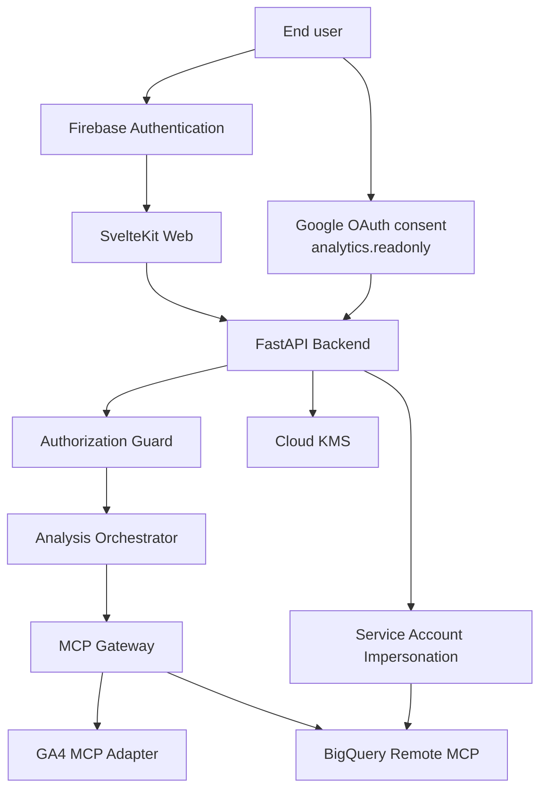

# Architecture

本システムはAPI ProxyではなくConversational Analytics Platformである。MCPはread-onlyなデータ取得手段であり、Identity、Authorization、Semantic、State、Safety、Evidence、VisualizationはApplicationが所有する。

会話エージェントは既存Orchestratorの上位でask/query/finishを制御する。目的・調査section・改善仮説をWorkspaceへ保存し、各queryは既存のSemantic／Gateway検証を通す。サイト設定はUID×DSS、定期Reportは登録者の現在のGrant／GA4接続で実行する。[ADR 0010](adr/0010-conversational-agent-and-scheduled-reports.md)を参照。localの結果blobはDocker共有volume、非localは従来のGCSに限定する。

通常経路では上位Workflow SkillとGA4 AnalysisSkillを分離し、小さいSchemaによる行動選択→GA4を選んだ場合だけ取得引数生成→取得結果の観測→次の判断とする。任意比較期間・実行traceを保持し、Planner障害でも可能なら根拠付きpartial回答を残す。限定半期agendaは別経路として残る。詳細と未完了の達成条件検査は[ADR 0011](adr/0011-agent-tool-and-workflow-contracts.md)を参照。



## 認証とデータIdentity

```text
Application login
  Firebase Google Login → Firebase UID

GA4 standard
  Firebase UID → same-account Google OAuth → USER_OAUTH Credential

GA4 optional
  Data Source Set(auth_mode=SERVICE_ACCOUNT) → Data Access Profile Service Account

BigQuery
  Data Access Profile → keyless Service Account Impersonation
```

GA4とBigQueryは同じData Source Setに共存できるが、Credentialは混ぜない。`USER_OAUTH`のGA4処理はBigQuery用Service Accountの状態やTool allowlistに依存せず、BigQuery処理はユーザーのOAuth Credentialを使用しない。自動fallbackは禁止する。

## Trust boundary

Browser、LLM、OAuth callback query、Property ID、SQL、Filter、Tool名はすべてuntrustedである。BackendはFirebase ID Tokenを検証し、active User、Company Member、厳密なUser Access Grant、Data Source Set、Sessionを読み直す。

GA4の最終許可条件は次の論理積である。

```text
OAuthしたGoogle UserがPropertyを閲覧可能
AND PropertyがData Source Setへ登録済み
AND Firebase UIDにUser Access Grantが存在
```

BigQueryは上記のApplication Grantに加えて、登録済みData Access Profile、Dataset／View allowlist、Service Account IAMを要求する。CallerやLLMのProperty／Project／DatasetをBackendが上書きまたは拒否する。

## GA4 OAuth flow

Backend Web Server Authorization Code Flowを使用する。`state`はhashだけをFirestoreへ保存し一度だけconsumeする。PKCE、`access_type=offline`、`include_granted_scopes=true`、`analytics.readonly`を必須とし、Firebase Google subject/emailとOAuth subject/emailを一致させる。

Refresh TokenはBackendでCloud KMS暗号化後、`ga4UserConnections/{uid}`へ暗号文だけを保存する。Cloud Run runtimeだけが対象CryptoKeyのEncrypter/Decrypterを持つ。Access Tokenは永続化せず、Token、Authorization Code、PKCE verifierをログへ出さない。

## Runtime components

- Web: Firebase Web SDK、Chat、OAuth connection status、Property候補、ECharts。
- API: Authorization、OAuth callback、Planner、Cache、Evidence、MCP Gateway。
- GA4 Adapter: pinned公式Toolをrequest-scoped `ContextVar` Credentialで実行する。
- BigQuery client: Remote MCP、固定Query Project、Query Guard、dry-run budget。
- Credential Broker: 明示的`SERVICE_ACCOUNT` GA4とBigQueryだけをProfile単位でimpersonateする。
- Dataset Cache: Firestore metadataとprivate Cloud Storage blob。
- Audit: Request ID、Firebase UID、Data Source Set、auth mode、実行Identityの非秘密metadata、Property／Dataset、Query Hash、Latency、Evidence ID。

## Failure policy

Authentication、Authorization、OAuth identity mismatch、Policy violationはretryしない。GA4のread-only一時障害だけをbounded backoffでretryする。User OAuthが失効した場合は`reauthorization_required`、Property権限が失われた場合は`ga4_property_access_denied`としてfail closedする。BigQuery live queryの曖昧な失敗は自動再実行しない。

Decisionの詳細は[ADR 0009](adr/0009-ga4-user-oauth-and-bigquery-service-account.md)を参照する。
