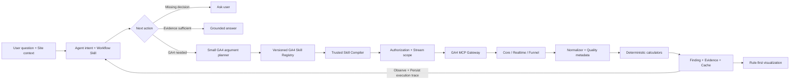

# GA4分析Skill設計調査

更新日: 2026-09-25
対象: GA4-onlyの高度化。BigQueryを必要とする機能は本調査の実装範囲外。

## 結論

調査開始時は、Semantic Layerで選ばれたMetric／Dimensionを1回の`run_report`へコンパイルする基本分析経路だった。2026-09-03の改修で、分析目的ごとのversion付きSkill、Core／Realtime／Funnel／Metadata経路、品質検証、budget、複数Metric処理を追加した。

改善では、LLMへToolを自由利用させるのではなく、分析目的ごとのversion付き`AnalysisSkill`をApplication側に登録する。PlannerはSkillとSemantic termだけを提案し、Backendが型付き入力、認可済みScope、互換性、quota、計算、Evidenceを決定する。

2026-09-13の再監査では、個別GA4 Skillの追加だけでは不十分と判断した。GA4取得をAgentの一つのCapabilityに位置付け、その上に「質問の目的を保つ／必要な調査を計画する／取得結果を観測する／不足を質問する／根拠から評価する」というWorkflow Skillを設ける。以下の新設計は改修方針であり、全項目の実装完了を意味しない。進捗は[todo.mdのA0](todo.md)で管理する。

## 2026-09-25 — Q3b：単一条件変更契約

実モデル追補: gemini-3.7-flashで絞込み・比較基準・軸・粒度・比較解除を同じ連鎖で2回検証し、取得計画12/12が初回から条件一致。アプリ安全制御4件も成功。合成データ・固定Summaryによる限定計画評価で、文章品質・任意文言の理解率・修復率は未測定。[実Gemini検証記録](evaluation/q3-live-planning-2026-09-25.md)

analysis.condition_change.v1（version 1.0.0）は、明示変更と保持条件を分離するWorkflow方針。年月指定の比較基準変更、比較解除、登録済み軸のA→B置換、日付軸の粒度置換に全文一致した場合に適用する。expectedとchanged_fieldsを計画入力に渡し、実際のコンパイル元Stateからの実行条件を取得前検査する。旧軸は必須条件から外し、残りの軸・指標・Filter・主期間を保持する。

比較解除はWorkspaceで「比較期間未指定」と区別する。修正前3ケース失敗→新規34件・6ターン継続、Backend全571件・型／Lint成功。認可と予算は不変。複合変更・任意文言・相対的比較基準・ランキング等の完全継承は含めない。実Geminiの限定結果は上記追補。[Q3b検証記録](evaluation/q3b-condition-change-2026-09-25.md)

## 2026-09-25 — Q3a：絞込み継承契約

analysis.filter_continuation.v1（version 1.0.0）は、新しいGA4 ToolではなくWorkflow側の条件保持契約。「その中でモバイルだけ」「Organic Searchのみ」等、登録Filterを使う短い肯定指示に全文一致し、既存Core分析の期間・指標がある場合だけ適用する。

Stateと有効なSemanticから期待する指標・軸・期間・比較期間・粒度・Filterを確定し、行動選択／GA4引数生成／取得前検査／完了判定を一致させる。Compiler後に条件が逸脱すればGA4へ送らず、Stateも変更しない。既存の計画回数・取得回数・deadline内で修復し、不足を残して完了にしない。

期間・指標・軸の明示変更、否定、改善相談、追加取得禁止、未登録語、Realtime／Funnel等、段階計画・定期実行は本契約で上書きしない。ランキング件数・順位基準・要約統計の完全継承も未実装。Skillは権限や任意Toolを増やさず、認可・Semantic・互換性検査は維持する。

修正前3ケース失敗→新規26件成功、Backend全537件・型／Lint成功。合成Planner／GA4での検証であり、実Geminiの生成品質を測った結果ではない。[検証記録](evaluation/q3a-filter-continuation-2026-09-25.md)。その後のQ3bは上記の別契約で扱う。

## 2026-09-14 — 複合集計と根拠の欠落を改善

実際の失敗報告では、`pagePathPlusQueryString × sessionSource`のクエリは成功していた。一方、単一期間のFindingには先頭Dimensionの代表値しかなく、最終回答へクロス集計の各セルが渡っていなかった。比較期間がある場合だけ`category_comparisons`で組合せが渡る非対称な設計が原因の一つだった。ユーザーが別途Skillを設定し忘れた問題ではない。

今回の共通修正:

- `ga4.cross_breakdown.v1`: 登録済み2〜4 Dimension、1〜4 Metric、期間比較、最大100行／期間。標準の`run_report`を使い、Credential・Property／Stream強制・互換性検査・全体3,000行制限は維持する。
- 「掛け合わせ」「クロス」「×」等の明示的な組合せは、同じクエリで軸を満たす契約へ変換する。ページ別と参照元別を別々に取得しただけでは完了にしない。個別分析の明示指示とは区別する。
- Findingへ全軸名と`category_values`（最大12個の正確な軸組合せ＋Metric値）を保存する。比較のない分析でもAIへ渡し、文章化失敗時もコードで内訳を表示する。重複キー・不完全な軸・非有限値を合算／補完しない。
- 過去のFindingは、同じ認可済みsectionの保存済み観測値から読み取り時に補完する。保存履歴の書換えやGA4の自動再取得はしない。
- 日付×カテゴリは単一の時系列合計として扱わない。UUや率の合算・単純平均をサイト全体値として表示しない。複数軸は表で表示し、先頭軸だけのグラフに潰さない。

検証パターン:

| 組合せ | 指標例 |
|---|---|
| ページ×参照元 | PV |
| LP×参照元／メディア | セッション、UU |
| チャネル×デバイス×ページ | PV |
| 国×ブラウザ | UU |
| イベント×デバイス | イベント数 |
| 月×チャネル | UU、エンゲージメント率 |
| ページ×参照元×デバイス×国 | PV、セッション、UU、エンゲージメント率 |

比較あり／なし、キャッシュ再利用、保存復元、誤った単独計画の修正をAutomated testで確認する。組合せが実プロパティで利用できるかは`checkCompatibility`による確認が必要であり、全組合せの実データAcceptance完了とはしない。

制約: 「PV上位10ページを先に確定し、各ページ内で参照元上位を取る」と「ページ×参照元の組合せ上位10件」は別の分析である。後者を前者と主張しないようAgent契約へ明記した。2026-09-15追記: 前者は[ADR 0012](adr/0012-conversation-memory-and-dependent-analysis.md)の`analysis.grouped_breakdown.v1`で、単一期間・1指標・2軸・最大10対象を一度の依頼で自動取得する。選定1回＋各対象の取得枠を探索型の4回制限から分離し、手動の「続き」を要求しない。進捗は保存し、時間・認可・返却件数の上限は維持する。全件取得、raw journey、server-side Pivotの実装完了とはしない。月×カテゴリの任意期間比較も、異なる年月を自動で同じセルとみなさない。

公式仕様確認: [runReport](https://developers.google.com/analytics/devguides/reporting/data/v1/rest/v1beta/properties/runReport)、[checkCompatibility](https://developers.google.com/analytics/devguides/reporting/data/v1/rest/v1beta/properties/checkCompatibility)。

## 2026-09-13: Agent ToolとWorkflow Skillの分離

### 分離改修前に確認した問題

- `AnalysisSkillRegistry`はGA4の単一呼出しを安全にコンパイルする契約が中心で、業務目的の達成条件や複数調査の計画を持たない。
- 行動判断・GA4引数・施策提案を一つの大きな生成Schemaに詰めており、必要なMetric／期間の欠落を修復しにくい。
- 任意の2絶対期間を比較する入力契約が不足している。登録済みの「流入元」Dimensionがあっても、比較の目的と指標補完を一貫して解決できるとは限らない。
- 半期の正規表現による初期計画と固定4観点agendaは限定的な復旧策。任意の月比較へ一般化されず、明示した分析軸を一般的な観点へ置き換えると質問への忠実さを失う。
- `agent_interrupted`だけでは停止原因が分からず、取得済み結果を活用した回答に進めない経路がある。

### 二層の契約

| 層 | 責任 | 例 |
|---|---|---|
| Agent Workflow Skill | 目的、必要情報、達成条件、調査観点、観測後の分岐、回答・確認質問、停止と復旧 | 流入比較、期間評価、根拠からの深掘り、施策相談 |
| GA4 AnalysisSkill／Tool Capability | 承認済みSemantic入力からGA4を安全に実行し、計算済みFinding・Evidenceを返す | `ga4.compare.v1`、`ga4.trend.v1`、`ga4.drilldown.v1` |

Agentの行動選択は、質問・GA4調査・根拠からの回答を区別する。GA4を選択した場合だけ小さいGA4専用Schemaで引数を生成し、既存Compiler→Authorization→Gatewayを通す。単なる質問や施策相談のためにGA4取得を必須にしない。将来Toolが増えても、個別の権限・型・予算・監査契約を用意してから公開する。これは任意MCP Toolの公開や、保留中BigQueryの有効化を意味しない。

Workflow Skillには次を持たせる。

- version、目的と適用例、必要な入力、未確定時の確認事項
- 明示期間・比較基準・Metric・Dimension・Filterの保持規則
- 使用できるCapabilityとGA4 AnalysisSkill、調査観点と完了条件
- 観測結果に応じた追加調査・質問・終了の規則
- 数値計算とEvidenceの要件、非加算Metric・欠落カテゴリの扱い
- 最大判断／実行／時間の予算、部分失敗時の回答方針
- ユーザー指示によるレポート作成条件、受入例と失敗例

Workflowは権限を付与しない。Skillの自然言語説明を信用してGuardを省略せず、実行する入力と根拠をコードで検査する。計画／実行traceの永続化と、同じOperationの応答を安全に再生するledgerは別の実装要件として扱う。

### 最初のVertical Slice: 流入元の2期間比較

入力例: 「2026年5月と2026年6月を比較した流入元の分析をしてください」。

1. 2期間を別々の絶対期間として保持する。方向が明示されていなければ後の月を評価対象、先の月を比較基準とする等の仮定を回答で説明する。月日数の違いを隠さない。
2. 「流入元」は登録済みのsession-scoped Dimensionへ解決する。指標未指定時は承認済みのSessions等から補い、その選択を明示する。ユーザーがUU等を指定した場合は上書きしない。
3. 必要な期間全体値と流入元別比較を計画し、各取得を既存Tool Capabilityで検証・実行する。取得済みEvidenceで足りる場合は再取得しない。
4. 比較は同じカテゴリ同士に限定し、上位結果にないカテゴリをゼロと見なさない。全体の増減寄与を主張するには、その計算に必要な全体値と対応カテゴリの根拠を要求する。
5. 取得結果から増減の確認済み事実、注目すべき流入元、不足、次の調査候補を回答する。因果関係や売上効果を断定しない。レポートartifactは明示指示がある場合だけ作る。

このsliceの後に、同じ契約を期間レビュー、観測済み流入元からのデバイス／ページ深掘り、サイト制約に基づく施策相談へ展開する。テンプレートを増やすだけでなく、実Geminiでの意図理解と実GA4の期間・指標・軸の突合を個別にAcceptanceする。

## 2026-09-13追加: 特定の質問ではなく共通分析基盤を改善

今回の流入元事例の実行履歴では、Semanticの`session_source`と取得計画は正しく選択されていた。失敗原因は2期間の結果が要求件数の2倍になるケースを、共通Executorが過大取得と判定していたこと。実GA4の同一クエリで、修正後は対象10行・比較10行を取得し、同一カテゴリ10件を照合できた。したがって、流入元Aliasを足すだけでは解決しない。

今回追加した仕組み:

- **Capability matrix**: `agent/capabilities.py`で、分析観点・登録済み項目・計測スコープ・前提・未対応機能を提供する。Global→Company→DSSの優先順位と利用不可定義を実行時と同じResolverで反映する。
- **共通の完了判定**: 明示MetricとDimensionを全Workflowで検査する。別々に取得した「参照元×セッション」と「全体UU」を「参照元×UU取得済み」とみなさない。対称2暦月指定では期間も照合し、実際の期間ラベルが両方あることを確認する。不足があれば再計画し、解消しなければpartialと不足内容を返す。
- **共通の比較計算**: 同一Dimension組合せの対象値・比較値・差分・変化率を`CategoryComparison`に保存する。参照元×メディアやチャネル×端末も別キーとして扱う。未取得／明示ゼロ／重複の曖昧さを区別し、非加算指標を合算しない。
- **共通の件数予算**: Core比較では期間別limitを検査し、全体3,000行の上限を取得前後に強制する。`rowCount`は返却件数と区別し、限定範囲であることをEvidenceへ残す。

| 分析観点・方式 | 現在の実行基盤で扱う内容 | 制約・次の拡張 |
|---|---|---|
| 集客 | 参照元、メディア、チャネル、キャンペーン別の登録済みKPI・比較・深掘り | session acquisitionとfirst-user／attributionを混同しない。全体寄与は別途根拠が必要 |
| コンテンツ | ページ・LP・タイトル等の閲覧／利用状況、上位・下位、期間比較 | ページ閲覧と入口ページを区別。高cardinalityの全件評価は未保証 |
| 属性・地域・技術 | 国・地域・性別・年齢・端末・ブラウザ等の内訳と比較 | thresholding、unknown、UU重複に注意。すべての組合せがGA4互換とは限らない |
| イベント・利用状況 | イベント数、エンゲージメント等、観測済み値の深掘り | イベントを勝手にCVとしない。CVRの正式な分母／分子契約は未完 |
| 時系列・異常候補 | 日・週・月・年の推移、対応指標の集計、median/MAD | 各期UUは合算不可。異常候補は因果説明ではない |
| Realtime／Funnel | 専用Schema、登録済みファネルのステップ分析 | 通常Reportと異なるSchema。実プロパティでの専用Acceptanceが必要 |
| 未登録項目・未対応方式 | 不足定義や制約を説明して確認する | Custom定義のAdmin承認、cohort／pivotの公式MCP対応検証、複合目的・多ターン達成条件は残タスク |

これは全GA4探索機能の実装完了ではない。次はこの共通契約の上で評価セットを広げ、計画が指定した項目・期間・粒度を保持するか、実GA4値と一致するかを観点ごとに検証する。新たなAPI経路や動的なSemantic承認をLLMへ解放する方針ではない。BigQueryはPendingを維持する。

公式仕様: [Data API標準フィールド](https://developers.google.com/analytics/devguides/reporting/data/v1/api-schema)、[runReport](https://developers.google.com/analytics/devguides/reporting/data/v1/rest/v1beta/properties/runReport)、[公式MCP Core Tool](https://github.com/googleanalytics/google-analytics-mcp/blob/main/analytics_mcp/tools/reporting/core.py)。APIに存在する機能と、固定バージョンのMCP・本アプリが実行できる機能を分けて評価する。

## 2026-09-03 実装状況

本調査の主要設計をGA4 Pilotへ反映した。ここでいう「Data APIの活用」は、公式Google Analytics MCP 0.7.0が提供するread-only分析面を、アプリの認可・Semantic・Evidence境界の中で使うことを指す。Data API RESTの全methodをLLMへ直接公開することではない。

| Capability | 実装状況 |
|---|---|
| version付きSkill Registry | KPI、Trend、Breakdown、Compare、Drilldown、Realtime、Funnel、Anomaly、Metadataをサーバー所有contractとして実装 |
| Core report | 複数Metric、最大2 Dimension、Semantic filter、複数date range、ranking、row budget、quota返却を型付きcompile |
| Compatibility | `checkCompatibility`を同一User OAuth Credentialで事前実行し、非互換を`run_report`前に拒否 |
| Realtime | Realtime専用Metric・Dimension allowlist、Stream Scope、非cache実行で会話Plannerに接続 |
| Funnel | AdminがSemantic Definitionに登録した2〜10 stepだけを使い、Gatewayが全stepへStream Scopeを強制注入 |
| Anomaly | 最大366行の集計時系列からBackendがmedian/MADロバストスコアを計算 |
| Custom metadata | Admin-only APIがProperty固有custom dimension・metricを候補として取得。Semanticへは自動公開しない |
| 時系列要約 | 加算Metricは既定で期間合計、質問の明示指示で平均／最新値を選択。非加算Metricの期間合計は実行前に拒否 |
| Evidence・UI | Skill/Semantic/Compiler version、quality metadata、quotaをEvidence/Auditへ保存。複数Finding、KPI Card、chart series、tableの履歴復元に対応 |

今回の実装後も、`ga4.driver_decomposition.v1`、CVRのversion付き計算契約、Property metadataとcustom definitionのAdmin承認・Semantic Version発行UIは未実装である。`batchRunReports`、Pivot、Audience Exportは現行の公式MCP Tool allowlistになく、GA4 Pilotの対話分析にも不要なため公開していない。

## 本書でいうSkill

ここでいうSkillはCodexやGeminiのプロンプトファイルではない。Production Application内の次の契約をまとめた、監査可能な分析Capabilityである。

以下は下位のGA4 AnalysisSkillの契約。上位のAgent Workflow Skillは前節の目的・達成条件・観測後の判断を追加する。

```text
Skill = Intent examples
      + typed input/output
      + state read/write rule
      + semantic requirements
      + allowed GA4 tool
      + trusted query compiler
      + step/row/quota budget
      + deterministic calculations
      + evidence/quality policy
      + visualization rule
      + acceptance fixtures
```

## 公式GA4／MCPで利用できる能力

Repositoryは公式Google Analytics MCPを`analytics-mcp==0.7.0`へpinしている。公式Repositoryは現時点でExperimentalとされ、Admin API／Data APIを使う次のread-only Toolを提供する。

- Property情報: `get_account_summaries`、`get_property_details`、`list_google_ads_links`
- Core report: `run_report`
- Property固有metadata: `get_custom_dimensions_and_metrics`
- Realtime: `run_realtime_report`
- Funnel: `run_funnel_report`

公式資料:

- [Google Analytics MCP guide](https://developers.google.com/analytics/devguides/MCP)
- [googleanalytics/google-analytics-mcp](https://github.com/googleanalytics/google-analytics-mcp)
- [MCP `run_report` implementation](https://github.com/googleanalytics/google-analytics-mcp/blob/main/analytics_mcp/tools/reporting/core.py)
- [MCP metadata implementation](https://github.com/googleanalytics/google-analytics-mcp/blob/main/analytics_mcp/tools/reporting/metadata.py)
- [MCP Realtime implementation](https://github.com/googleanalytics/google-analytics-mcp/blob/main/analytics_mcp/tools/reporting/realtime.py)
- [MCP Funnel implementation](https://github.com/googleanalytics/google-analytics-mcp/blob/main/analytics_mcp/tools/reporting/funnel.py)

Data API上の重要な前提:

- Core、Realtime、Funnelは別のquota categoryと互換性規則を持つ。
- `run_report`は複数date range、Dimension／Metric filter、order、limit／offset、property quota返却を扱える。
- Property metadataは標準項目に加え、Property固有のcustom dimensions／metrics、key event rate metricsを返せる。
- Core reportのMetric／Dimensionは非互換な組合せがあるため、`checkCompatibility`で実行前に確認できる。
- RealtimeはCoreと対応Schemaが異なり、custom metricsは利用できない。
- Funnelは集計されたuser journeyを返せるがv1alphaであり、breaking changeとsamplingを考慮する必要がある。
- 大規模・高cardinality・複雑なReportはquota消費が増える。sampling、thresholding、`(other)` row、unique count近似が回答精度に影響する。

関連資料:

- [Data API dimensions and metrics](https://developers.google.com/analytics/devguides/reporting/data/v1/api-schema)
- [Metadata](https://developers.google.com/analytics/devguides/reporting/data/v1/rest/v1beta/properties/getMetadata)
- [Compatibility](https://developers.google.com/analytics/devguides/reporting/data/v1/rest/v1beta/properties/checkCompatibility)
- [Realtime schema](https://developers.google.com/analytics/devguides/reporting/data/v1/realtime-api-schema)
- [Funnel reporting](https://developers.google.com/analytics/devguides/reporting/data/v1/funnels)
- [Data API quotas](https://developers.google.com/analytics/devguides/reporting/data/v1/quotas)
- [Reporting data expectations](https://developers.google.com/analytics/devguides/reporting/data/v1/reporting-data-expectations)

## 現状できること

| Capability | 現状 | 主な制約 |
|---|---|---|
| User OAuthとProperty discovery | 実装済み | 候補からDSS／Grantを自動作成するv1.2違反がある |
| Core KPI | Users、Sessions、PV、Engagement、Event、Key Event、ECなどを複数同時取得 | Property固有custom fieldはAdmin承認後にSemantic Version発行が必要 |
| 時系列 | 日／週／月／年、複数Metric series。加算Metricは既定で期間合計、明示指示で期間平均／最新値を選択 | 非加算Metricの期間合計は拒否し、既定では最新値を使う |
| Breakdown | channel、device、LP、page、event、source/medium、campaign、geo、browser等 | Filter値はSemantic allowlist登録が必要 |
| Ranking | 上位／下位1〜100、metric order | 1 Metric／主Dimensionを前提にする |
| 比較 | 前期間、前週、前月、前年 | 任意の2つの絶対期間を直接指定するUIは未実装 |
| 会話継続 | period、comparison、複数Metric／Dimension、型付きFilter、time grain、Skill | 「さっきのLP」の明示Finding参照は未実装 |
| Cache | Scope、期間、粒度、Metric、Dimension、Filterをhash化 | local memory cacheはBackend再起動で消える構成がある |
| Evidence／計算 | value、difference、ratio、change rate、rank、additive contribution、anomaly score | CVRのversion付きcontractは未実装 |
| Visualization | 複数KPI、multi-series line/bar、donut、table | 2つ目以降のDimensionはtableでのみ表示 |
| Realtime | Planner〜Evidenceへ接続済み | Realtime専用Schema allowlistのみ |
| Funnel | 登録済みstepとStream filter guardをPlanner〜Evidenceへ接続 | segment／next actionはfail-closed |
| Custom definitions | Admin-only候補取得APIを実装 | Admin review、Semantic Version発行UIは未実装 |
| Compatibility／Quota | Core事前互換性、Property quota、quality metadataを実装 | 実Propertyでのquota／thresholding Acceptanceは未実施 |

Repository上の根拠:

- [`ga4/chat_sessions.py`](../services/analysis-api/src/analytics_ai/ga4/chat_sessions.py): Property候補からDSS／Grantと固定4 Metric等を作成
- [`orchestrator/planning.py`](../services/analysis-api/src/analytics_ai/orchestrator/planning.py): version付きSkill選択、複数Metric／Dimension、時間粒度、Ranking、比較、明示的な期間要約をtrusted queryへcompile
- [`orchestrator/service.py`](../services/analysis-api/src/analytics_ai/orchestrator/service.py): 複数Finding、期間合計／平均／最新値、Cache／Evidence／Visualization
- [`mcp_gateway/gateway.py`](../services/analysis-api/src/analytics_ai/mcp_gateway/gateway.py): Tool allowlist、Property／Stream Scope、row／filter guard
- [`ga4/adapter.py`](../services/analysis-api/src/analytics_ai/ga4/adapter.py): 公式Toolのrequest-scoped Credential Adapter

### 現在成立する質問例

- 「今月のユーザー数」
- 「月別のアクティブユーザー数」
- 「今週のPVランキングを上位10で」
- 「Organicだけ」→「モバイルだけ」→「前月比較」
- 「今の結果をグラフにして」

ただし、結果のScopeがAdmin登録済みStreamへ固定された後にのみProduction相当とみなす。

### 2026-09-02 改修前ベースライン

以下は本改修前に、コード、dev Firestoreの保存状態、公式Data API contractを照合した時点の記録である。改修後の状態は「2026-09-03 実装状況」を正とする。

| 質問パターン | 判定 | 検証内容／制約 |
|---|---|---|
| 「2026年6月のUU」 | 対応 | `activeUsers`、指定期間、KPI Finding／Evidence |
| 「過去12か月を月別にUUで」 | 部分対応 | `yearMonth`と折れ線は対応。期間要約は最新行を代表値にするため高度レポートとしては未完成 |
| 「今週のPVランキングを上位10で」 | 対応 | `pagePathPlusQueryString`、PV降順、limit 10をコードで強制 |
| 「性別／年齢層ごとのUUを表で」 | 対応 | 登録済みDimensionを決定論的に補正し、table specを生成 |
| 「Organic Searchの中でモバイルだけ」 | 対応 | version付きSemantic値を再解決し、channel/device filterとStateへ保存 |
| 「Organicだけ」→「モバイルだけ」→「前月比較」 | 対応 | 既存期間・Metric・Filterを継承。実Property Acceptanceは別途必要 |
| 「今月の主要KPIをまとめて経営レポートに」 | 未完成 | GA4へ複数Metricを渡せてもFinding／可視化は先頭Metricだけ |
| 「PV減少の原因をチャネル→デバイス→ページで分析」 | 未完成 | bounded multi-step driver decomposition Skillが未実装 |
| 「直近30分の状況」 | 未完成 | Realtime ToolはAdapterまでで会話Plannerに未接続 |
| 「登録済みステップのファネル」 | 未完成 | Funnel ToolはAdapterまででSkill／Admin step contractが未実装 |

Analysis State調査では、実データ上で`focus.dimension=device_category`または`user_gender`へ更新されていても、FrontendがDimensionを表示せず、Channel／Device欄だけを表示していた。また`ga4-oauth-v1`にはchannel/deviceの集計軸定義はあったが、`Organic Search`や`mobile`などのフィルター値定義がなかった。修正後はDimensionを独立表示し、Channel／DeviceはFilterであることを明示する。標準の許可済みchannel/device値をSemantic Definitionへ追加し、明示語をPlanner後に決定論的に補正する。

ここでいう「対応」は1回のCore `run_report`へ安全にコンパイルできることを示す。自由形式の複数章レポート、複数Metricの完全なFinding、原因分解、Realtime、Funnelまで完成したことを意味しない。

## 目標アーキテクチャ



GA4引数Plannerが返してよいのは`skill_id`、期間、Semantic term、型付きFilter、比較、粒度、top-Nだけにする。Property ID、Stream ID、Credential、MCP Tool名は返却Schemaに含めない。GA4 MCP Tool名はSkill RegistryからBackendが選ぶ。Agentの上位行動選択とこのGA4引数生成を別Schemaにし、文章化はさらに根拠参照専用のSchemaで検査する。

## AnalysisSkill contract案

```json
{
  "id": "ga4.breakdown_rank",
  "version": "1.0.0",
  "source": "ga4",
  "allowed_tools": ["run_report"],
  "input": {
    "period": "required",
    "metrics": {"min": 1, "max": 3},
    "dimensions": {"min": 1, "max": 2},
    "filters": "semantic_allowlist_only",
    "top_n": {"min": 1, "max": 100}
  },
  "state_policy": {
    "inherit": ["period", "metrics", "filters"],
    "replace": ["dimensions", "top_n"]
  },
  "budget": {
    "max_tool_calls": 1,
    "max_rows": 100,
    "timeout_seconds": 30
  },
  "calculation_policy": ["rank", "share_if_additive"],
  "visualization_policy": "bar_or_table",
  "evidence_policy": "required"
}
```

実装ではJSONをそのまま信用せず、Pydantic modelとコード上のCompilerを対応付ける。Skill version、Semantic version、Compiler versionをDataset／Finding／Auditへ保存する。

## 推奨Skill catalog

### 1. `ga4.kpi_snapshot.v1`

期間内の複数KPIを一度に取得し、各Metricに独立したFindingとKPI Cardを作る。

改善後:

- 「今月の主要KPI」でUsers、Sessions、PV、Engagement Rateを同時表示
- Metricごとのunit、aggregation、比較規則を正しく適用
- 1つのMetric失敗が全結果を曖昧にしない型付きerror表示

### 2. `ga4.trend.v1`

日／週／月／年の時系列を取得し、期間合計・平均・最新値をMetric定義に従い分離する。

改善後:

- 「過去12か月の月別UU」で月順のグラフと期間要約
- activeUsersのような非加算Metricを月跨ぎで単純合算しない
- 欠損期間、sampling、data freshnessを注記

### 3. `ga4.breakdown_rank.v1`

Dimension別の分解、top／bottom、構成比を扱う。

改善後:

- page、LP、event、channel、source／medium、campaign、device、geoへ拡張
- 「PV上位10」「ユーザー減少が大きいチャネル」を別の計算規則で処理
- 高cardinality Dimensionへ小さなlimitを強制

### 4. `ga4.compare.v1`

同一条件の2期間を比較し、差分、比率、変化率、寄与をBackendで計算する。

改善後:

- 前期間、WoW、MoM、YoY、明示期間比較
- 期間長不一致を検出し、比較前提をEvidenceへ保存
- additiveでないMetricには誤った寄与計算をしない

### 5. `ga4.drilldown.v1`

既存Analysis Stateへ、認可済みDimensionまたはFilterを1段追加する。

改善後:

- 「Organicを深掘り」→channelを固定してLP／device候補を提案
- 「その中でモバイルだけ」→既存Filterを失わずdeviceを追加
- 「さっきのLPだけ」→明示的なFinding／Dataset参照で曖昧性を解消

### 6. `ga4.metadata_discovery.v1`

Property固有custom dimensions／metricsを取得し、Semantic Definition候補を作る。自動公開しない。

改善後:

- Company固有の用語とcustom fieldをAdmin review画面でmapping
- API name、scope、description、compatibilityを保存
- 承認後に新Semantic Versionとして会話へ公開

### 7. `ga4.realtime.v1`

Realtime専用Schemaとquotaで直近状況を分析する。

改善後:

- 「今リアルタイムで何人？」
- country、device、event等のRealtime対応Dimensionだけで分解
- Core専用custom metricを混ぜず、Stream Scopeを強制

### 8. `ga4.funnel.v1`

Adminが登録したevent step templateだけを使い、集計Funnelを実行する。

改善後:

- 情報サイトの「page_view→特定ページ→予約完了」等を明示定義できる
- device等のbreakdown、completion／abandonmentを表示できる
- v1alpha変更、sampling、Application側のstep上限をcontractで管理できる

Funnel stepをUser promptから無制限に生成してはならない。Event／Parameter／next action／segmentはSemantic allowlistとStream Scopeでコンパイルする。

### 9. `ga4.anomaly_scan.v1`

日次／週次の小さな集計結果に対し、Backendコードで移動中央値、MAD、季節比較等を計算する。LLMは説明だけを行う。

改善後:

- 「最近いつもと違う動きは？」に候補日とEvidenceを提示
- 判定式、window、thresholdを再現可能にする
- 異常候補からbreakdown Skillへ安全に遷移する

### 10. `ga4.driver_decomposition.v1`

比較で差が大きい場合に、許可済みDimensionを順番に最大数回だけ照会する。

改善後:

- 「PVが落ちた理由」でchannel→device→pageの寄与候補を提示
- 途中結果ごとにDataset／Evidenceを残す
- `max_tool_calls`、quota残量、minimum effect sizeで暴走を防ぐ

これは因果推論ではなく、GA4集計上の寄与候補である。回答にもその限界を明記する。

## Security／Correctness invariants

- SkillはProperty、Stream、Credentialを入力に持たず、Authorized SessionからGatewayが注入する。
- Property候補はSkill実行Scopeではない。Admin登録済みData Source SetとUser Grantが必須。
- Skillは固定Tool allowlistを持ち、LLMがToolを選ばない。
- Semantic未登録のMetric／Dimension／Filter／Eventは実行しない。
- Custom definitionはmetadata取得だけで自動有効化せず、Admin承認とVersion発行を必須にする。
- 数値、比較、順位、寄与、異常判定、Funnel rateはBackendで計算またはGA4の型付きMetricとして検証する。
- `return_property_quota`、最大row、最大tool call、timeoutをSkillごとに強制する。
- sampling、thresholding、`(other)`、unique count近似をEvidenceで失わない。
- Cache KeyはSkill／Compiler／Semantic version、Scope、期間、Metric、Dimension、Filter、grain、comparisonを含む。
- Skill間遷移でも毎回SessionとGrantを再認可する。

## GA4だけではできないこと

BigQueryをPendingにしている間、次は提供しない。

- raw event sequenceを使う任意のUser Journey
- User単位の詳細な行動列や自由なpath reconstruction
- CRM／Sales／別DatasetとのJOIN
- raw textの大量分類、要約、Embedding
- GA4 UI／Data APIが返さないevent parameterの自由分析
- BigQuery Exportを前提とした高度SQL

Funnel Skillは集計Funnelであり、raw event journeyの代替ではない。GA4 Data API側のsampling、thresholding、unique count近似、`(other)`の影響も除去できない。

## 実装順序

以下は再監査後の順序。既に実装したRegistry、multi-metric Finding、Compatibility等は作り直さず回帰を維持する。

1. 行動選択／GA4引数／最終回答の契約を分離し、任意2期間の流入比較と失敗時回答を完成させる。
2. Workflow Skillの達成条件と実行traceを基に、観測後の追加調査・確認質問・施策相談を検証する。
3. 安全なOperation再送・再開、Skill予算の全強制、metadata review／CVR計算契約を順に完成させる。
4. リリース前にv1.2のP0を必ず解消する。候補からのDSS／Grant自動作成を除外し、Admin登録・Stream・Property metadataを固定する。
5. KPI、Trend、Breakdown、Compare、Drilldownと会話の実GA4 Acceptance、OAuth分離・失効・quota・品質・並行実行を確認する。
6. Realtime、Funnel、Anomaly、Driver decompositionの未確認部分を段階的に検証する。BigQueryはPending、新規クラウド作成は別承認とする。

設計判断: [ADR 0011 — Agent ToolとWorkflow Skillの契約](adr/0011-agent-tool-and-workflow-contracts.md)。
